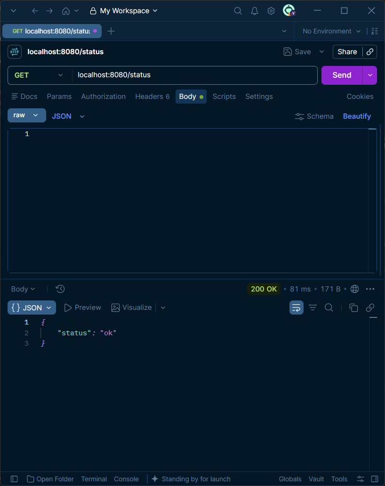
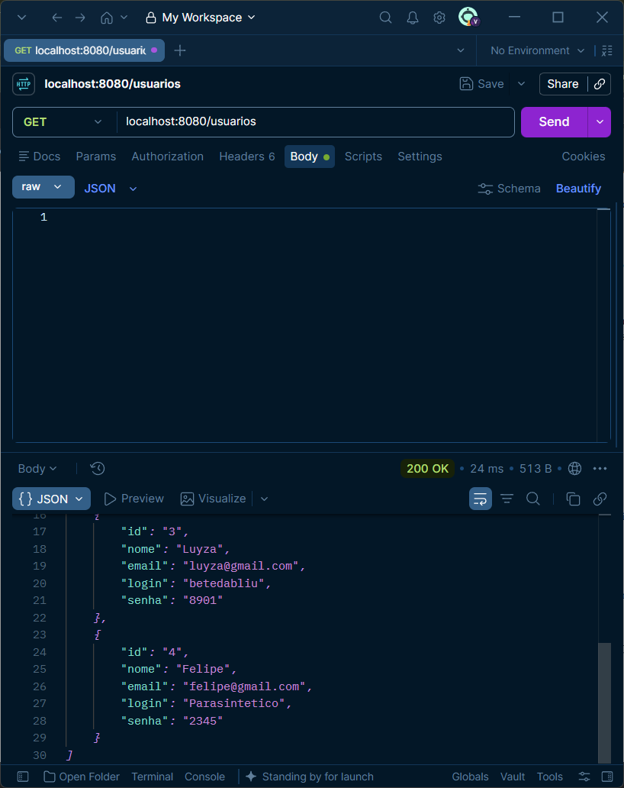
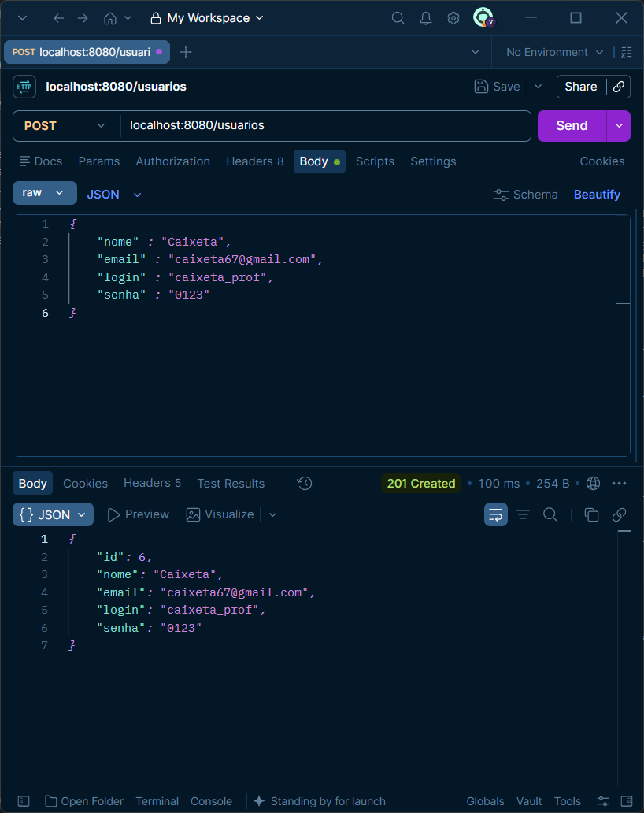
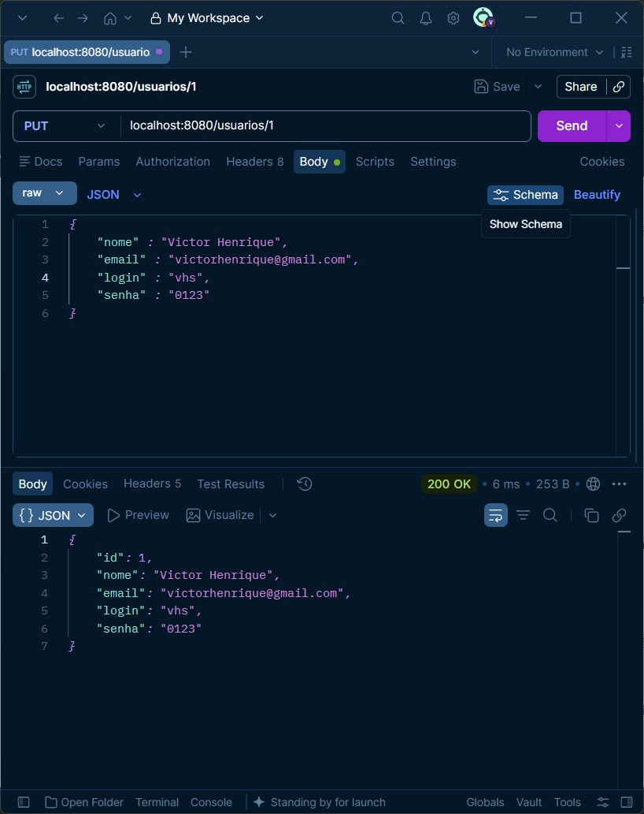
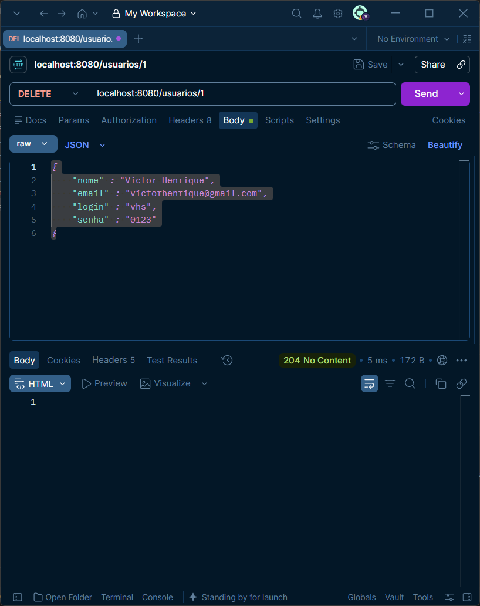
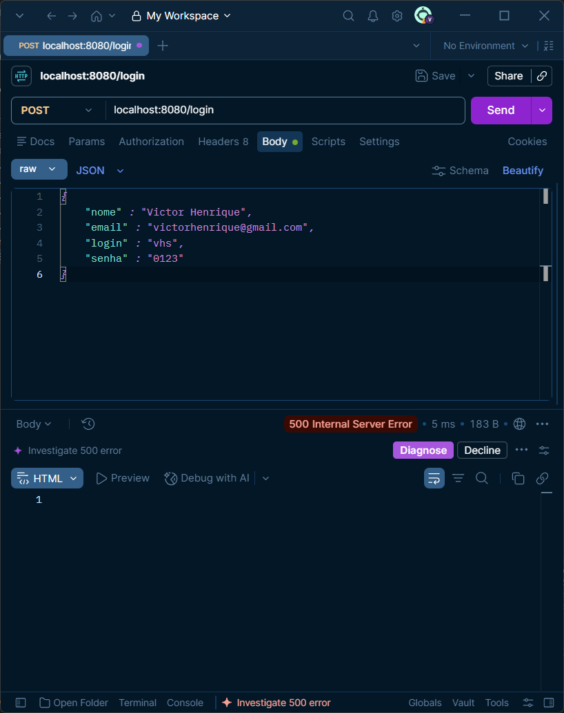
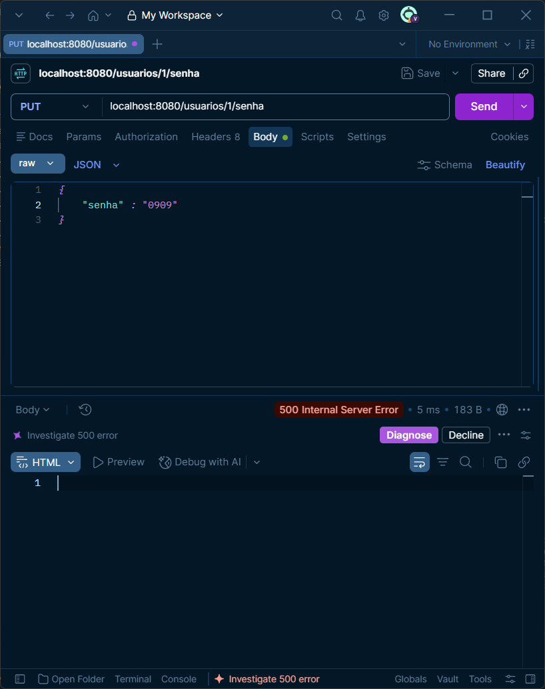

Nome: Victor Henrique Souza
Curso: 2° Informática
UC: Desenvolver Serviços Web

Para instalar as dependências:
* Digitar "composer require slim/slim" e "composer require slim/psr7" no terminal do VSCode.

Decisões técnicas:
* Decidi aprimorar o código dos métodos ao adicionar algumas excessões, e evitar falhas.

Prints:
* 
GET /status

* 
GET /usuarios

* 
GET /usuarios/1

* 
POST /usuarios

* 
PUT /usuarios/1

* 
DELETE /usuarios/1

* 
POST /login

* 
PUT /usuarios/1/senha